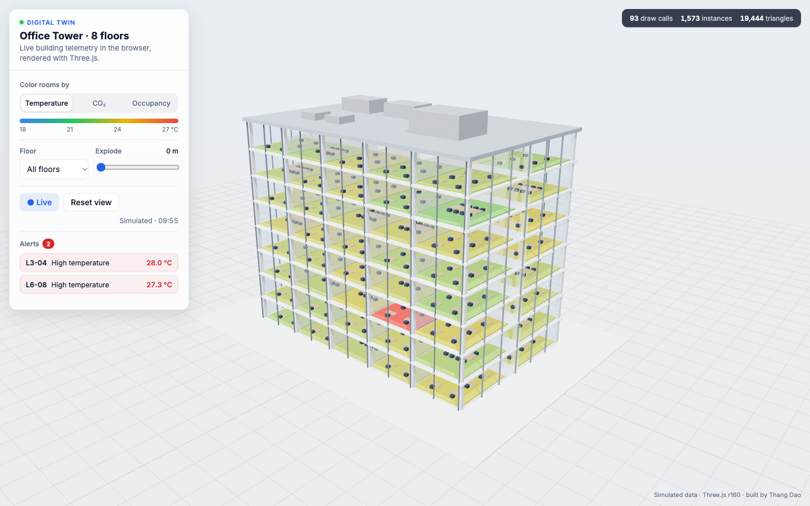
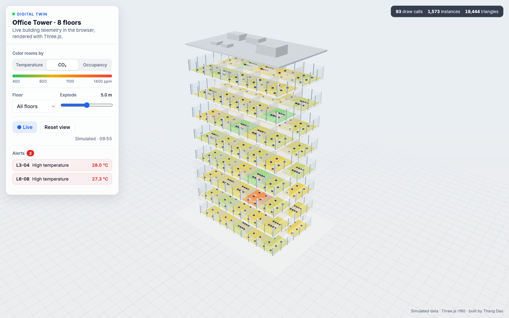
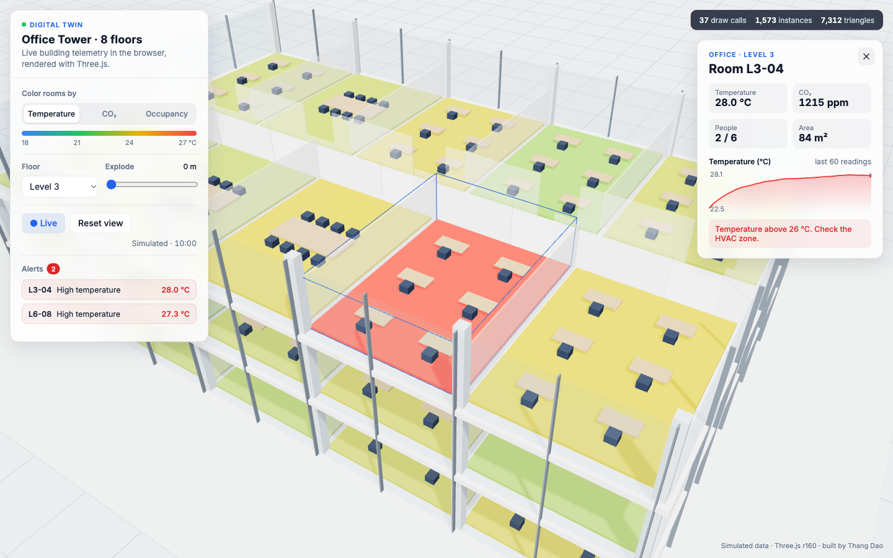

# Building Digital Twin (Three.js)

An interactive digital twin of an 8-floor office tower, running entirely in the browser. Each room is colored by live sensor data (temperature, CO₂, occupancy). You can explode the floors, isolate a level, click any room for its history, and jump to rooms that raise alerts.

**Live demo:** _add your GitHub Pages link here_



| Exploded floors, colored by CO₂ | Room detail with live history |
|---|---|
|  |  |

## Features

- **Procedural building model**: floors, rooms, glass partitions, furniture, columns and facade are all generated in code. No external model files.
- **GPU instancing**: about 1,600 objects (desks, chairs, walls, columns, room tiles) are drawn in about 90 draw calls by using `InstancedMesh` with per-instance colors.
- **Live telemetry simulation**: each room has its own temperature, CO₂ and occupancy model, driven by a time-of-day occupancy curve. Two rooms carry an HVAC fault so the alerting has something real to catch.
- **Heatmap modes** with a matching legend, switchable at runtime.
- **Explode and isolate** controls to separate floors or cut the building down to one level.
- **Picking**: hover shows a tooltip; clicking a room opens a panel with a 60-sample sparkline and a recommended action.
- **Alerts list**: clicking an alert flies the camera to the room.
- **Performance overlay** showing FPS, draw calls, instances and triangles.
- **Responsive**: on phones the controls become a bottom sheet.

## Run locally

```bash
python3 -m http.server 8000
# open http://localhost:8000
```

There is no build step. Three.js r160 loads from a CDN through an import map.

URL parameters, useful for screenshots and deep links:
`?metric=co2&explode=5`, `?floor=3&room=L3-04`

## Swapping in real data

`tick()` in `main.js` is the only place the sensor values change. To use a real feed, replace the simulation with a WebSocket or MQTT handler that writes `temp`, `co2` and `people` on each room, then call `paint()`. To replace the procedural floors with a real BIM or glTF model, map each room mesh to a room id.

## Tech

Three.js (WebGL), OrbitControls, PBR materials with a RoomEnvironment, `InstancedMesh`, raycasting on instanced meshes, and Canvas 2D sparklines. Plain ES modules, no framework.

---

Built by **Thang Dao**, a CesiumJS / WebGIS / Three.js developer. All data here is simulated.
